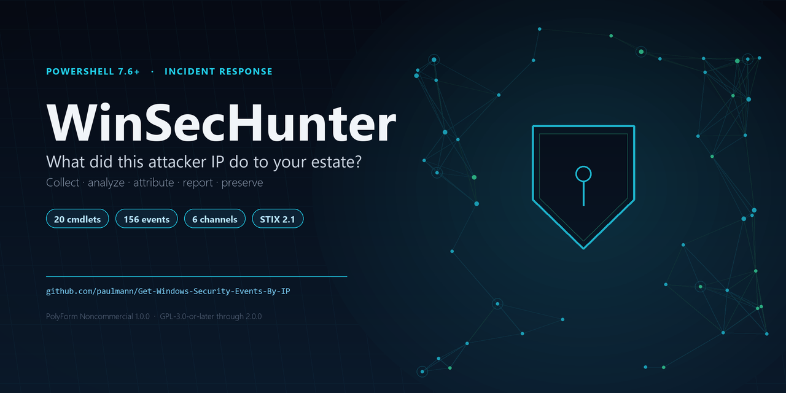

<div align="center">

# 🛡️ WinSecHunter

**Incident-response toolkit for Windows security events.**

Collect everything an attacker IP did — locally, across hosts, or from offline EVTX — then prove it, report it and hand it over.

[](https://github.com/paulmann/Get-Windows-Security-Events-By-IP/actions/workflows/ci.yml)
[](https://github.com/paulmann/Get-Windows-Security-Events-By-IP/releases)
[](https://aka.ms/powershell)
[](#platform-support)
[](#build-test-contribute)
[](./LICENSE)



[Quick start](#quick-start) · [Commands](#command-reference) · [For agents](#for-ai-agents) · [Reports](#reporting-and-abuse) · [Wiki](https://github.com/paulmann/Get-Windows-Security-Events-By-IP/wiki)

</div>

---

## What it is

WinSecHunter answers one question completely: **what did a given attacker IP do to this estate?**

It sweeps Windows event logs — local host, remote hosts over WinRM/CIM, or acquired `.evtx` files — for every record that references an IPv4, IPv6 or CIDR. It normalizes and decodes the records, detects brute force and spraying, reconstructs logon sessions, attributes the address, and then produces the three artifacts an investigation actually needs: a narrative incident report, a ready-to-send abuse report, and indicators in CSV/JSON/STIX.

Everything is one PowerShell 7.6+ module: **20 cmdlets**, **156 catalogued events** across **6 channels**, **14 hunt profiles**, and an in-module reference (`Show-WinSecHunterHelp`).

> **Provenance.** WinSecHunter is a complete refactoring of `Get-SecurityEventsByIP.ps1` v5.0.2 by Mikhail Deynekin into a typed, tested, cross-platform module. The legacy script is no longer part of `main`; it remains available at tag [`v5.0.2`](https://github.com/paulmann/Get-Windows-Security-Events-By-IP/tree/v5.0.2) and as a release asset, and is no longer maintained.

---

## At a glance

| | |
|---|---|
| **Collection** | local · WinRM/CIM multi-host · offline EVTX |
| **Channels** | Security · System · RDP (RCM/LSM) · Firewall · Sysmon |
| **Analysis** | brute force · spraying · stuffing · lockout storm · success-after-failure · sessions · timeline · audit gaps |
| **Enrichment** | PTR/ASN always · AbuseIPDB · AlienVault OTX · ip-api (optional) |
| **Reporting** | incident report (MD + self-contained HTML) · abuse report (`.eml`) · IOC (CSV/TXT/JSON/STIX 2.1) |
| **Evidence** | SHA-256 manifest · integrity verification · case re-import |
| **Quality** | 168 passing tests · PSScriptAnalyzer 0/0 · CI on Linux + Windows |
| **Runtime** | PowerShell 7.6+ (Core); collection on Windows, analysis anywhere |

---

## Why it exists

The legacy script answered one question well but could not survive production use: a single 1,092-line file, `Write-Host`/`exit`, no tests, `-MaxEvents` applied before time filtering, one log channel, and no way to hand evidence to anyone else.

| Concern | Legacy script | WinSecHunter 2.1 |
|---|---|---|
| Structure | one 1,092-line file | module, typed classes, 20 cmdlets |
| Channels | Security only | Security, System, RDP, Firewall, Sysmon |
| Collection | local only | local, WinRM/CIM, offline EVTX |
| Failure model | one missing channel aborts | per-channel status; missing channel = `Skipped` |
| Evidence | CSV/HTML | bundle + SHA-256 manifest + verification |
| Reporting | table dump | incident report, abuse report, IOC/STIX |
| Quality | none | 168 tests, analyzer gate, CI matrix |

---

## Capabilities

### Collect

| Cmdlet | Answers |
|---|---|
| `Get-WinSecEventByIp` | Which events reference this IP/CIDR — here, on remote hosts, or in EVTX? |
| `Trace-WinSecIp` | What is happening right now, per log, without re-reading history? |
| `Get-WinSecLogCoverage` | Can these logs prove anything: retention, size, wrap risk, access? |

### Analyze

| Cmdlet | Answers |
|---|---|
| `Get-WinSecIpTimeline` | When did it happen — buckets, histogram, top accounts and hosts? |
| `Get-WinSecLogonSession` | Who is still logged on, from where, with what privileges? |
| `Test-WinSecBruteForce` | Brute force, spraying, stuffing, lockout storm, success after failure? |
| `Test-WinSecAuditPolicy` | Would the missing audit policy have hidden this activity? |

### Enrich

| Cmdlet | Answers |
|---|---|
| `Resolve-WinSecIpAttribution` | Whose address is it — PTR, ASN, country, reputation? |
| `Expand-WinSecIpRange` | What addresses does this CIDR actually cover? |

### Report

| Cmdlet | Answers |
|---|---|
| `New-WinSecIncidentReport` | What do I hand to management, the customer, the case file? |
| `New-WinSecAbuseReport` | What do I send to the network that hosts the attacker? |
| `Export-WinSecIocList` | What do I feed into a TIP, SIEM or blocklist? |

### Preserve

| Cmdlet | Answers |
|---|---|
| `New-WinSecCase` | What is the scope, who owns the case, what was noted when? |
| `Export-WinSecInvestigation` | What is the immutable evidence bundle and its hashes? |
| `Import-WinSecCase` | Can I reopen this investigation next week with typed data? |
| `Test-WinSecEvidenceIntegrity` | Has anything been modified, removed — or added? |

### Reference

| Cmdlet | Answers |
|---|---|
| `Get-WinSecEventCatalog` | What is catalogued, with ATT&CK mapping and IP-bearing fields? |
| `Get-WinSecHunterOption` / `Set-WinSecHunterOption` | How is the tool configured, and is the change valid? |
| `Show-WinSecHunterHelp` | The whole toolkit, one cmdlet, or Markdown for docs. |

---

## Quick start

```powershell
# 1. Get and install (no admin required, per-user module path)
git clone https://github.com/paulmann/Get-Windows-Security-Events-By-IP.git
cd Get-Windows-Security-Events-By-IP
./build/Install-Dev.ps1 -Force

# 2. Collect: last 48 hours, with per-channel status
$events = Get-WinSecEventByIp 203.0.113.7 -LastDays 2 -PassHostStatus

# 3. Prove what the logs can answer
Get-WinSecLogCoverage -LogName Security
Test-WinSecAuditPolicy

# 4. Analyze
$events | Get-WinSecIpTimeline -AsciiChart
$findings = $events | Test-WinSecBruteForce
$sessions  = $events | Get-WinSecLogonSession -ActiveOnly

# 5. Preserve
$case = New-WinSecCase -SubjectIps 203.0.113.7 -Title 'RDP brute force vs VPN tier'
$case = Export-WinSecInvestigation -Case $case -Event $events -Finding $findings `
            -Session $sessions -Format All -PassThru

# 6. Report
New-WinSecIncidentReport -Case $case -Event $events -Finding $findings -Session $sessions `
    -Template Full -Format Both -PassThru
New-WinSecAbuseReport -Case $case -Event $events -Finding $findings `
    -ReporterEmail 'soc@contoso.com' -ReporterOrg 'Contoso SOC'
Export-WinSecIocList -Case $case -Event $events -Finding $findings -Format Stix21

# 7. Verify before sharing
Test-WinSecEvidenceIntegrity -Path .\WSC-20261021-XXXXXXXX -Summary
```

Need the map at any moment:

```powershell
Show-WinSecHunterHelp
Show-WinSecHunterHelp -Cmdlet New-WinSecAbuseReport
Show-WinSecHunterHelp -Markdown -OutFile .\docs\Command-Reference.md
```

---

## Scenarios

### RDP brute force that succeeded

```powershell
$events   = Get-WinSecEventByIp 203.0.113.7 -LastDays 3 -Profile IncidentResponse -PassHostStatus
$findings = $events | Test-WinSecBruteForce -WindowMinutes 30
$findings | Format-Table Pattern, Severity, TargetAccount, FailureCount, SuccessCount

# The report escalates to "Credential compromise — success observed after failures"
New-WinSecIncidentReport -Case $case -Event $events -Finding $findings `
    -Template Executive -Format Html -PassThru
```

### Multi-host sweep that explains every host

```powershell
$status = Get-WinSecEventByIp 203.0.113.7 -ComputerName (Get-Content .\hosts.txt) `
            -Credential (Get-Credential) -ThrottleLimit 16 -LastHours 12 -PassHostStatus

$status | Format-Table Computer, Status, EventsFound, ErrorMessage
$status | ForEach-Object { $_.LogDetails } | Group-Object Status | Select-Object Name, Count
```

### Offline EVTX from an acquired disk

```powershell
$events = Get-WinSecEventByIp 198.51.100.9 -Path D:\Evidence\*.evtx -Profile All
$events | Export-WinSecInvestigation -Format All -OutputDirectory D:\IR -PassThru
```

### Indicators to a TIP and a report to the ISP

```powershell
$attribution = Resolve-WinSecIpAttribution 203.0.113.7 -Provider None
Export-WinSecIocList -Case $case -Event $events -Finding $findings -Format Stix21
New-WinSecAbuseReport -Case $case -Event $events -Finding $findings -Attribution $attribution `
    -ReporterEmail 'soc@contoso.com' -ReporterOrg 'Contoso SOC' -RedactAccounts
```

---

## Reporting and abuse

`New-WinSecIncidentReport` writes `<CaseId>-incident-report.md` and `.html` into `<CaseId>-reports/`. The HTML is fully self-contained — inline CSS, no scripts, no external requests — so it can be attached to a ticket or opened offline.

Templates: `Executive` (verdict, severity, confidence, key facts, actions), `Technical` (scope, timeline, findings, IOCs, sessions, coverage, recommendations, custody), `Full` (Technical + events by ID + ATT&CK coverage).

`New-WinSecAbuseReport` produces an `.eml` you can open in any mail client and send:

- recipient resolved from ASN/PTR across major clouds (AWS, Azure, GCP, DigitalOcean, Hetzner, OVH, Cloudflare, Contabo, Linode, Vultr, Oracle, Alibaba, Tencent); unknown networks require `-ContactEmail` — the tool never invents an address;
- plain-text body with source facts, UTC window, counts, sample events and requested action;
- `events.csv` and `evidence.json` attached as base64;
- `-RedactAccounts` applies stable pseudonyms to the body **and to the attachments**.

Reports never go inside the evidence bundle, so `Test-WinSecEvidenceIntegrity` stays green.

---

## Evidence and chain of custody

```text
WSC-20261021-AB12CD34/
  events.csv / events.json / events.clixml
  findings.json
  sessions.csv
  coverage.csv
  attribution.json
  timeline.csv
  iocs.csv / iocs.json
  report.html / report.md
  case.json
  manifest.json          ← SHA-256, bytes, UTC write time for every artifact
```

```powershell
$s = Test-WinSecEvidenceIntegrity -Path .\WSC-20261021-AB12CD34 -Summary
if (-not $s.IsIntact) { $s.Rows | Where-Object Status -ne 'OK' | Format-Table }

$b = Import-WinSecCase -Path .\WSC-20261021-AB12CD34
$b.Events | Get-WinSecIpTimeline -AsciiChart
```

`Extra` is a first-class status: a hash list cannot detect a file added after export, the verifier can.

---

## Platform support

| Capability | Windows | Linux / macOS |
|---|---|---|
| Collect local logs | ✅ (Security log requires elevation) | ❌ |
| Collect over WinRM/CIM | ✅ | ✅ (with PowerShell remoting) |
| Offline EVTX | ✅ | ✅ where `Get-WinEvent -Path` exists |
| Analysis, reporting, evidence, import | ✅ | ✅ |

No external binaries, no cloud dependency, no telemetry. The only outbound requests are the enrichment providers you enable and reverse DNS.

---

## Configuration

```powershell
Get-WinSecHunterOption                     # effective values
Set-WinSecHunterOption -DefaultProfile BruteForce -DefaultMaxEvents 20000
Show-WinSecHunterHelp                      # all 15 options with defaults
```

| Location | Value |
|---|---|
| Windows | `%LOCALAPPDATA%\WinSecHunter\config.json` (via `[Environment]::GetFolderPath`) |
| Linux/macOS | `$XDG_CONFIG_HOME/WinSecHunter/config.json` or `~/.config/WinSecHunter/config.json` |
| Override | `WINSECHUNTER_CONFIG_DIR` (portable IR kit) |

Threat-intel keys are read only from environment variables named by configuration (`AbuseIpDbKeyEnvVar`, `OtxKeyEnvVar`) — never parameters, never written to disk. `config.json` is written atomically.

---

## For AI agents

This section is the machine protocol: how to obtain, install, verify and use the product without a human in the loop, and what to do when something breaks.

### 1. Download

Preferred: the release asset (no git history, fixed version).

```powershell
$version = '2.1.0'
$zip = Join-Path $env:TEMP "WinSecHunter-$version-module.zip"
$dir = Join-Path $env:TEMP "WinSecHunter-$version"
Invoke-WebRequest "https://github.com/paulmann/Get-Windows-Security-Events-By-IP/releases/download/v$version/WinSecHunter-$version-module.zip" -OutFile $zip -UseBasicParsing
Expand-Archive -LiteralPath $zip -DestinationPath $dir -Force
```

Alternative: clone the repository when you need tests, build scripts or docs.

```powershell
git clone --depth 1 https://github.com/paulmann/Get-Windows-Security-Events-By-IP.git
```

### 2. Install

Portable (recommended for agents — nothing outside the working directory):

```powershell
Import-Module (Join-Path $dir "WinSecHunter/$version/WinSecHunter.psd1") -Force
```

Per-user installation (persists across sessions):

```powershell
./build/Install-Dev.ps1 -Force
```

### 3. Verify before use

```powershell
$m = Get-Module WinSecHunter
$m.Version.ToString()                    # 2.1.0
$m.ExportedFunctions.Count               # 20
@(Get-WinSecEventCatalog).Count          # 156
```

If any number differs, stop and report — do not continue with a partial install.

### 4. Use non-interactively

Rules that prevent most agent failures:

| Rule | Why |
|---|---|
| Always pass a window (`-LastHours`, `-LastDays`, or `-StartTime`/`-EndTime`) | An unbounded query is slow and proves nothing |
| Always add `-PassHostStatus` for remote sweeps | `Skipped` means "no visibility", not "no activity" |
| Never use `Read-Host`, `Get-Credential` or `Pause` | The session is non-interactive; pass `-Credential` explicitly |
| Never put API keys in a command line | Keys come from environment variables only |
| Check `LogDetails` before concluding "nothing happened" | A missing Security channel is a coverage gap |
| Keep bundles read-only after export | Any change breaks integrity |

Minimal pipeline:

```powershell
$events   = Get-WinSecEventByIp -IpAddress $ip -LastHours 24 -PassHostStatus -WarningAction SilentlyContinue
$findings = $events | Test-WinSecBruteForce
$case     = New-WinSecCase -SubjectIps $ip -Title "Agent sweep $ip"
$case     = Export-WinSecInvestigation -Case $case -Event $events -Finding $findings -Format All -PassThru
$report   = New-WinSecIncidentReport -Case $case -Event $events -Finding $findings -Template Technical -Format Both -PassThru
$check    = Test-WinSecEvidenceIntegrity -Path $case.CaseId -Summary
[pscustomobject]@{ Events = @($events).Count; Findings = @($findings).Count; Intact = $check.IsIntact; Report = $report.Files[0].Path }
```

Success criteria: the command completes without a terminating error, `Intact = True`, and the report path exists. `Events = 0` is a valid result only when `LogDetails` shows channels as `Completed` or `NoEvents`; `Skipped`/`Failed` must be reported as a coverage limitation.

### 5. Report bugs — please do

If anything fails, behaves unexpectedly, or contradicts this README, open an issue:

**https://github.com/paulmann/Get-Windows-Security-Events-By-IP/issues/new/choose**

Include:

1. WinSecHunter version (`(Get-Module WinSecHunter).Version`), PowerShell version and OS.
2. The exact command (redact addresses, accounts and host names if sensitive).
3. Expected vs actual behaviour, including the full error (`Get-Error | Out-String`).
4. For collection problems: `-PassHostStatus` output with `LogDetails`, and whether the session was elevated.
5. Whether the module was imported portable or installed.

Do **not** paste API keys, event dumps with personal data, or evidence bundles. Security vulnerabilities go through [SECURITY.md](SECURITY.md), never a public issue.

Feature requests are welcome in the same tracker; describe the incident task, not only the desired switch.

---

## Troubleshooting

| Symptom | First check |
|---|---|
| `No events` but activity is known | `Get-WinSecLogCoverage` (retention) and `Test-WinSecAuditPolicy` (audited?) |
| `Access is denied` reading Security | run elevated; the channel requires Administrator |
| A host failed | `-PassHostStatus`: `Status` plus `LogDetails` per channel |
| Sysmon/RDP channel missing | expected on servers without those roles; `Skipped`, sweep continues |
| Audit policy analysis empty | `auditpol` needs elevation; parsing is positional, localization-safe |
| Report hashes do not match | files changed after export; re-export and keep bundles read-only |
| Abuse recipient empty | `NeedsContact = true`; pass `-ContactEmail` |
| `Install-Module` fails | use the release zip or `build/Install-Dev.ps1` |

More: [Troubleshooting and FAQ](https://github.com/paulmann/Get-Windows-Security-Events-By-IP/wiki/Troubleshooting-and-FAQ).

---

## Build, test, contribute

```powershell
./build/validate.ps1 -Tests            # AST, manifest, exports, help, PSSA, Pester
./build/Build-Module.ps1 -Zip          # validated artifact + zip under output/
./build/Install-Dev.ps1 -Force         # install into the user module path
./build/Export-CatalogDoc.ps1          # regenerate docs/EventCatalog.md and Command-Reference.md
./build/Export-CatalogDoc.ps1 -Check   # exit 10 when generated docs are stale
```

Baseline: **168 passed, 0 failed, 1 skipped**, PSScriptAnalyzer **0 Error / 0 Warning**, 20 exports.

See [CONTRIBUTING.md](CONTRIBUTING.md) for conventions and the definition of done, and [SECURITY.md](SECURITY.md) for the security model.

---

## Documentation

| Document | Contents |
|---|---|
| [Architecture](docs/Architecture.md) | layers, query engine, per-channel executor, reporting pipeline |
| [Examples](docs/Examples.md) | runnable scenarios end to end |
| [Audit Policy Guide](docs/AuditPolicyGuide.md) | what must be audited for the tool to see anything |
| [Event Catalog](docs/EventCatalog.md) | 156 events with ATT&CK mapping (generated) |
| [Command Reference](docs/Command-Reference.md) | every cmdlet, parameter and example (generated) |
| [Wiki](https://github.com/paulmann/Get-Windows-Security-Events-By-IP/wiki) | task-oriented guides, reporting, evidence, development |
| [CHANGELOG](CHANGELOG.md) | release history |

---

## Licence

**PolyForm Noncommercial License 1.0.0** — free for noncommercial use; commercial use, support and custom terms require a licence: **mid1977@gmail.com**. Full text: [LICENSE](LICENSE).

WinSecHunter is a derivative work of `Get-SecurityEventsByIP.ps1` by **Mikhail Deynekin** (mid1977@gmail.com, https://deynekin.com). Releases up to 2.0.0 were published under GPL-3.0-or-later; 2.1.0 is relicensed by the copyright holder under PolyForm Noncommercial 1.0.0. Attribution is preserved in the manifest and in every source header.


