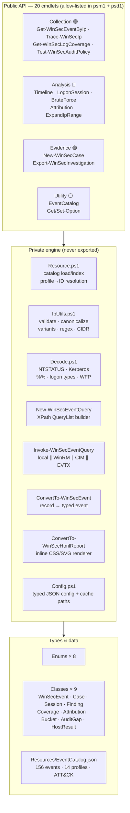
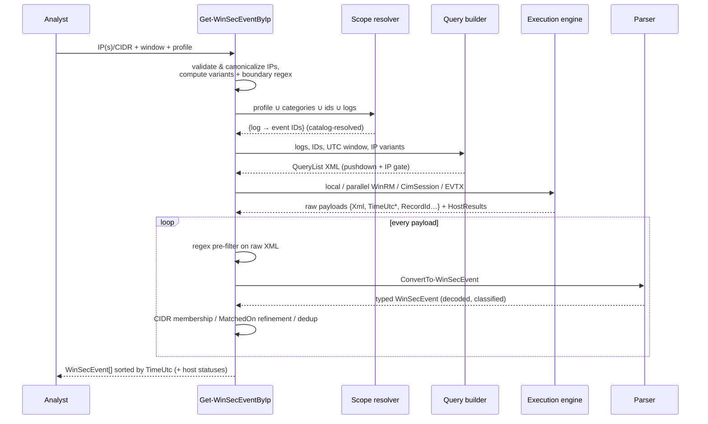
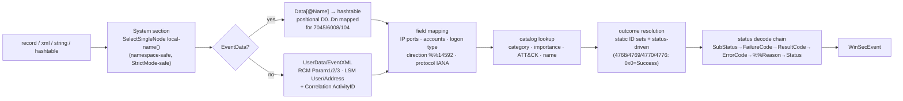
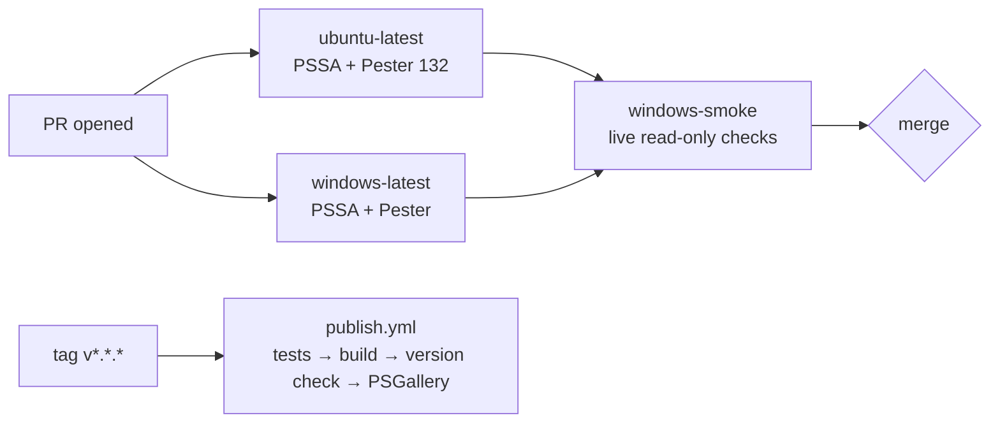
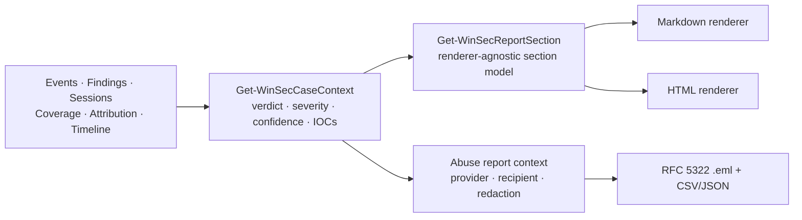

# 🏗️ Architecture

How WinSecHunter is built — layer model, query pipeline, parser design,
catalog schema, type system, and the testing strategy that keeps all of it honest.

[← Home](Home)

---

## Design principles

1. **Correctness under hostile data.** Missing channels, unparseable records,
   weird IPv6 renderings, 500k-event logs, unreachable hosts — every one of
   these is an expected input, not an exception path.
2. **Pure logic separated from Windows I/O.** Parsing, decoding, detection,
   timeline and rendering are side-effect-free functions of their inputs →
   the 132-test suite runs on Linux CI without a single event log.
3. **Evidence discipline.** UTC everywhere for analysis, dual timestamps on
   every event, per-host accountability, hash manifests on export.
4. **Pipeline-native.** No `Write-Host`/`exit` in library code; objects in,
   objects out; `ShouldProcess` on everything that mutates.
5. **Boring technology.** Dot-sourced module layout, JSON resources, no
   compiled dependencies, no experimental language features — debuggable at
   3 a.m. during an incident.

## Layer model



**Loader order** (`WinSecHunter.psm1`): `Enums → Classes → Private → Public` —
class definitions reference enum types at compile time, so order is load-bearing.
Classes are module-scoped; consumers needing type names use
`using module WinSecHunter` (objects work without it).

## The collection pipeline



### The 3-layer match strategy

| Layer | Where | What | Why |
|---|---|---|---|
| 1 · Pushdown | event log service | channel + `EventID` set + `TimeCreated` UTC window; **exact single IP**: `EventData/Data='v'` for every textual variant + `UserData/EventXML/Address='v'` | huge logs scan at native speed; time window bounds work (legacy truncated *before* filtering) |
| 2 · Verification | client | boundary-aware compiled regex over the whole record XML | catches mapped/compressed IPv6 renderings the equality gate can't express; CIDR membership via structural field tests |
| 3 · DeepScan | client | same regex, **gate disabled** | IPs inside command lines, UNC paths, task XML — thorough sweeps |

IDs **without** IP fields (4740, 4776, 7045, 4698…) always pass through layer 1
ungated — contextual evidence survives even though the IP never appears in it.
Event Log XPath has no `contains()`; this design works *with* the query dialect
instead of fighting it.

### Remote execution contract

```powershell
# what actually runs on each target (simplified):
$records = Get-WinEvent -FilterXml ([xml]$queryText) -MaxEvents $max
foreach ($r in $records) {
    @{ Xml = $r.ToXml(); Computer = $r.MachineName; RecordId = $r.RecordId
       TimeUtc = $r.TimeCreated.ToUniversalTime()   # ← computed SOURCE-side
       LogName = $r.LogName; Message = … }
}
```

Hashtables (not classes) cross the wire → no module needed on targets,
CLIXML-safe, parse centrally. `ForEach-Object -Parallel` fans out with
`-ThrottleLimit`; each host gets retry + stopwatch; results are labeled with
the requested name *and* the resolved `COMPUTERNAME`. Missing channels surface
as `Skipped`, transport errors as `Failed` — see
[Remote Collection](Remote-Collection#per-host-status-model).

## Parser design (`ConvertTo-WinSecEvent`)

One function, many inputs: `EventLogRecord` (duck-typed — no Windows-only type
references at definition time), `[xml]`, raw XML string, or the remote payload
hashtable. That single property is what makes parser tests run on Linux CI.



Decoding chain detail: 4625's `Status` is generic (`0xC000006D`) — the
**SubStatus** carries the truth (`0xC000006A` incorrect password). The chain
tries the most specific field first per event family, falling back with the raw
code preserved. Tables: [Reference Tables](Reference-Tables).

## Catalog schema

`Resources/EventCatalog.json` is the knowledge base — profiles, classification,
audit requirements and docs all derive from it:

```json
{
  "version": "2.1.0",
  "logs":      { "Security": "Security", "RCM": "Microsoft-Windows-TerminalServices-RemoteConnectionManager/Operational", "…": "…" },
  "logAliases":{ "RDP": ["…RCM…", "…LSM…"], "Firewall": ["…"], "Sysmon": ["…"] },
  "profiles":  { "BruteForce": { "description": "…", "eventIds": [4624, 4625, "…"] },
                 "IncidentResponse": { "description": "…", "categories": ["Authentication", "…"] } },
  "events": [
    { "Id": 4625, "Log": "Security",
      "Name": "An account failed to log on",
      "Category": "Authentication", "Importance": "Critical",
      "Attack": ["T1110.001", "T1110.003", "T1078"],
      "IpFields": ["IpAddress"],
      "Notes": "Primary brute-force indicator. Decode SubStatus: 0xC000006A bad password, …" }
  ]
}
```

Integrity is test-enforced: unique `Log|Id`, valid enum categories/importance,
well-formed ATT&CK IDs, profile references resolvable. Human-readable mirror:
[docs/EventCatalog.md](https://github.com/paulmann/Get-Windows-Security-Events-By-IP/blob/main/docs/EventCatalog.md)
(regenerated by `build/Export-CatalogDoc.ps1` — never hand-edited).

**Adding an event ID** = one JSON entry (+ optional profile membership).
Nothing else changes — parser, query builder and audit matrix pick it up.

## Type system

| Class | Role |
|---|---|
| `WinSecEvent` | normalized event (see [property dictionary](Reference-Tables#winsecevent-property-dictionary)); `GetDedupKey()`, `ToHashtable()` |
| `WinSecCase` | investigation container: id, operator, subject IPs, notes, findings, evidence registry |
| `WinSecSession` | reconstructed logon session with admin/pivot/duration facts |
| `WinSecBruteForceFinding` | detection result with severity, rates, evidence |
| `WinSecLogCoverage` | completeness snapshot with risk rating |
| `WinSecIpAttribution` | enrichment result, offline fields + provider fields |
| `WinSecTimelineBucket` | one histogram bucket (feeds SVG renderer) |
| `WinSecAuditGap` | audit-policy deficiency + remediation command |
| `WinSecHostResult` | per-target execution status |

Enums give compile-time-safe vocabulary: `WinSecEventCategory` (22 values,
ATT&CK-tactic aligned), `WinSecOutcome`, `WinSecVerdict`, `WinSecSeverity`,
`WinSecExportFormat`, `WinSecDirection`, `WinSecHostStatus`, `WinSecLogonType`
(numeric = wire values).

## Configuration & secrets

Typed JSON overlay (defaults ⊕ file), coerced on read **and** write, corrupt-file
tolerant, `WINSECHUNTER_CONFIG_DIR` relocatable. Secrets: env-var *names* in
config, values never — see [Configuration](Configuration#secrets-model).

## Platform notes

| Surface | Windows | Linux/macOS |
|---|---|---|
| Module import | ✅ | ✅ (Windows-only cmdlets guard at call time with actionable `PlatformNotSupportedException`) |
| Collection / coverage / audit / trace | ✅ | ❌ guarded |
| Analysis on exported CLIXML/JSON | ✅ | ✅ |
| HTML/CSV/JSON/Markdown export | ✅ | ✅ |
| Attribution (PTR + providers) | ✅ | ✅ (`System.Net.Dns` + `Invoke-RestMethod`) |

## Testing strategy

| Layer | How | Count (v2.1.0) |
|---|---|---|
| Pure logic | Pester 5, any OS: parser (real-world XML fixtures incl. UserData/Sysmon/7045 positional), decoders, IP math, XPath builder, detection, sessions, timeline, renderer, export+hash verification, config | **132** |
| Module contract | manifest/exports/help/OutputType/ShouldProcess/no-`Write-Host`/AST-parse gates | in suite |
| Static analysis | PSScriptAnalyzer, Error+Warning = 0 (CI gate; `TypeNotFound` diagnostic filtered — module-scoped classes) | CI |
| Live smoke | `windows-smoke` CI job: build → import → read-only `Get-WinSecLogCoverage`/catalog/local loopback sweep/audit read on the runner | CI |



## Repository layout

```text
├── src/WinSecHunter/           ← the module (ships as-is)
│   ├── WinSecHunter.psd1/.psm1/.Format.ps1xml
│   ├── Enums/ Classes/ Private/ Public/ Resources/
├── tests/                      ← Pester 5 suite + TestHelpers.ps1
├── build/                      ← Build-Module · Install-Dev · validate · Export-CatalogDoc
├── docs/                       ← repo-side docs (Architecture, Examples, AuditPolicyGuide, EventCatalog)
├── wiki/                       ← this wiki's source
├── .github/workflows/          ← ci.yml · publish.yml
└── README.md · CHANGELOG.md · LICENSE · PSScriptAnalyzerSettings.psd1
```

## 2.1.0 execution and reporting model

**Per-channel execution.** The XPath builder emits one `QueryList` with a `Select` per
channel. `Split-WinSecQueryXml` turns it into one single-`Select` query per channel, and the
executor runs them independently. A missing channel therefore produces one `Skipped` row in
`WinSecHostResult.LogDetails` instead of failing the host. `-MaxEvents` is a per-channel cap.

**Error classification.** `Get-WinSecLogErrorKind` maps `HResult`/Win32 codes first
(5 = access denied, 15007 = channel not found, 2/3 = not found), then falls back to the
message. No branch depends on an English OS string.

**Time bounds.** `[datetime]::MinValue` is the "not set" sentinel. `$null` cannot bind to
`[datetime]`, and `[Nullable[datetime]]` is unboxed during parameter binding, so `HasValue`
is not reliable.

**Reporting pipeline.**



Both renderers consume the same section model, so Markdown and HTML can never disagree about
a number or a verdict. Reports are written to `<CaseId>-reports`, outside the evidence bundle,
so the manifest stays verifiable.

---

**Next:** [Development →](Development) · Related: [Problem Domain](Problem-Domain) · [ROADMAP](ROADMAP)

