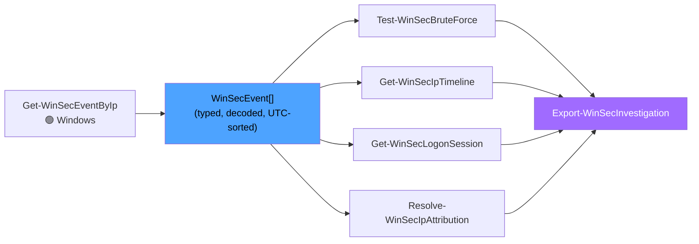
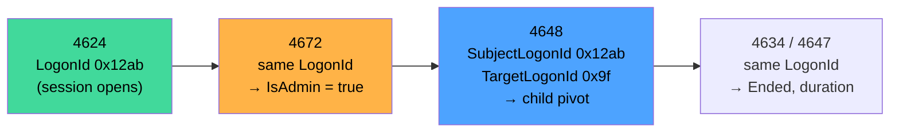

# 🕵️ Detection & Analysis

How WinSecHunter turns event streams into verdicts — algorithms, thresholds,
tuning, and how to read each result.

[← Home](Home)

---

## Table of contents

1. [The analysis pipeline](#the-analysis-pipeline)
2. [Test-WinSecBruteForce: patterns & algorithms](#test-winsecbruteforce)
3. [Tuning thresholds](#tuning-thresholds)
4. [Session reconstruction](#session-reconstruction)
5. [Timelines & the success-after-failure indicator](#timelines)
6. IP attribution → dedicated page: [Threat Intel & Attribution](Threat-Intel-and-Attribution)

---

## The analysis pipeline

All analysis cmdlets are **pure and pipeline-native** — they consume
`WinSecEvent` objects and run on any OS. Collect once, analyze many ways:



Because events are typed objects, you can also round-trip them:
`Export-Clixml` on the collection VM → `Import-Clixml` on your analysis box
(no Windows needed for anything below).

---

## Test-WinSecBruteForce

### Input classification

| Bucket | Event IDs | Rule |
|---|---|---|
| **Failures** | 4625, 4771, 4776 (non-zero status), RCM 1148, 5632/5633, 4649 | `Outcome = Failure` |
| **Successes** | 4624, RCM 1149, LSM 21/25, 4768/4769 (0x0), 4776 (0x0) | `Outcome = Success` |
| **Lockouts** | 4740 | by ID |

> [!NOTE]
> 4776/4768/4769 appear in *both* lists depending on their status code — the
> parser resolves outcome per record (`0x0` → Success), which is exactly the
> decoding the legacy script lacked.

### Patterns

| Pattern | Grouping key | Trigger (defaults) | Severity | ATT&CK |
|---|---|---|---|---|
| `BruteForce` | (source IP, account) | ≥ **5** failures inside **10 min** sliding window | High | T1110.001/.003 |
| `PasswordSpraying` | (source IP) | ≥ **5 distinct accounts** failed inside window | High | T1110.003 |
| `CredentialStuffing` | (account) | ≥ **3 distinct sources** failed inside window | High | T1110.001 |
| `LockoutStorm` | global | ≥ **3** lockouts (4740) in scope | Medium | T1110 |
| **`BruteForceWithSuccess`** | any of the above | **a success** for same source/account within **30 min** after burst start | **Critical** | T1078 |

The burst search is a proper **sliding window maximum** (two-pointer over
UTC-sorted events), not a fixed-bucket count — a 5-attempt burst straddling a
bucket boundary still triggers.

### Reading a finding

```powershell
$findings = $events | Test-WinSecBruteForce
$findings | Format-List
```

```text
Pattern                : BruteForceWithSuccess
Severity               : Critical
TargetAccount          : CORP\svc_backup
SourceIp               : 203.0.113.7
SourceHosts            : {VPN01}
FailureCount           : 47
SuccessCount           : 1
DistinctAccounts       : 2
AttemptsPerMinute      : 6.3
FirstSeenUtc           : 2026-10-04 03:12:44Z
LastSeenUtc            : 2026-10-04 03:41:02Z
SucceededAfterFailures : True
Description            : 47 failed logons from 203.0.113.7 against CORP\svc_backup within 10 min
                         (6.3/min). SUCCESS observed after failures (VPN01 event 4624 at
                         2026-10-04 03:41:02Z) — assume compromise: isolate host, reset
                         credentials, review sessions.
Evidence               : {48 × WinSecEvent}
```

Triage playbook for `SucceededAfterFailures = True`:

1. `Get-WinSecLogonSession` → find the session, its `IsAdmin` flag and children (4648 pivots).
2. Re-sweep the account (not the IP): `Get-WinSecEventByIp` finds IPs, but pivot
   destinations may use *new* sources — hunt the `LogonId` chain and 4648 `TargetServerName`.
3. Check `DefenseEvasion` profile on the victim host (1102/104/4719) — did they blind it?
4. Preserve: `Export-WinSecInvestigation -Format All`.

### Tuning thresholds

```powershell
# Per-invocation
$events | Test-WinSecBruteForce -FailureThreshold 10 -WindowMinutes 5 -SprayAccountThreshold 8

# Persistent defaults
Set-WinSecHunterOption -Options @{
    BruteForceFailureThreshold      = 10
    BruteForceWindowMinutes         = 5
    BruteForceSprayAccountThreshold = 8
}
```

| Scenario | Suggested tuning |
|---|---|
| Service accounts with flaky passwords (false positives) | raise `FailureThreshold`, or exclude the account from collected events upstream |
| Slow-and-low attackers (1 attempt/min) | widen `WindowMinutes` to 30–60, lower threshold |
| Large-scale spraying from botnets | stuffing rule catches it (≥3 sources/account); widen window |
| Lockout noise from one broken laptop | raise `LockoutThreshold` |

> [!IMPORTANT]
> Thresholds trade sensitivity against noise — but **never raise
> `SuccessWindowMinutes` reasoning away a success**: any success after failures
> for the same source/account deserves a human decision, which is why the
> finding escalates to Critical and lists the exact success event.

---

## Session reconstruction

`Get-WinSecLogonSession` chains events by normalized `LogonId` per computer:



| Property | Why you care |
|---|---|
| `IsAdmin` | 4672 seen → attacker had an admin token on this host |
| `Ended` = false | **No logoff recorded — the session may still be live.** With `-ActiveOnly`, this is your "still inside" list |
| `ChildLogonIds` | 4648 explicit-credential logons spawned from this session = pivot graph edges |
| `LogonType` | 3 = SMB/network, 10 = RDP, 9 = runas /netonly (token games), 2 = console (physical/KVM) |
| `AuthPackage` | `NTLM` where Kerberos is expected → pass-the-hash / downgrade smell |
| `GetDuration()` | dwell time per session |

LogonId normalization: `0x12AB`, `0x0000000012ab`, `12ab` all collapse to `12ab` —
chains never break on formatting.

```powershell
$events | Get-WinSecLogonSession |
    Where-Object IsAdmin |
    Sort-Object StartUtc |
    Format-Table LogonId, Account, Computer, LogonType, SourceIp, StartUtc, IsAdmin, Ended
```

---

## Timelines

`Get-WinSecIpTimeline` emits **one summary object first**, then typed buckets:

```powershell
$t = $events | Get-WinSecIpTimeline -AsciiChart
$summary = $t[0]                       # WinSecTimelineSummary
$buckets = $t | Select-Object -Skip 1   # WinSecTimelineBucket[]

$summary.SuccessAfterFailure           # compromise indicators, independent of thresholds
$summary.LogonTypes                    # {LogonType, Count, Meaning}
$summary.TopAccounts / TopHosts / EventBreakdown / AttackIds
$summary.AsciiChart                    # console-safe strings
```

```text
WinSecHunter timeline — 214 events, 2026-10-04 03:00:00Z → 2026-10-04 09:00:00Z (UTC), bucket 01:00:00
10-04 03:00 | ██████████████████████████████ 118  4625x94, 4771x18, 4740x6
10-04 04:00 | █████ 12                        4624x2, 4672x2, 4648x1
10-04 05:00 |  0
…
!! SUCCESS AFTER FAILURE (possible compromise):
   CORP\alice on VPN01: 94 failure(s) from 2026-10-04 03:12:44Z, then event 4624 at 2026-10-04 03:41:02Z
```

Notes:

- Buckets auto-size (1 h / 6 h / 1 d) unless `-BucketSize` is given; all bucket
  math is UTC.
- The success-after-failure indicator uses a 1-hour lookahead per
  (computer, account) pair — it is *threshold-independent*, unlike
  `Test-WinSecBruteForce`; both should agree on real compromises.
- Buckets feed the SVG histogram in the exported HTML report automatically when
  passed to `Export-WinSecInvestigation -Timeline`.

---

## Putting it together

A complete analysis pass in one pipeline block:

```powershell
$events    = Get-WinSecEventByIp 203.0.113.7 -ComputerName $hosts -Credential $cred -LastDays 2 -PassHostStatus
$findings  = $events | Test-WinSecBruteForce
$sessions  = $events | Get-WinSecLogonSession
$timeline  = $events | Get-WinSecIpTimeline
$attrib    = $events | ForEach-Object SourceIp | Where-Object { $_ } | Sort-Object -Unique |
                 Resolve-WinSecIpAttribution
$coverage  = Get-WinSecLogCoverage -ComputerName $hosts -Credential $cred -CoveringFrom (Get-Date).AddDays(-2)

Export-WinSecInvestigation -Event $events -Finding $findings -Session $sessions `
    -Timeline $timeline -Attribution $attrib -Coverage $coverage -Format All
```

## Verdict escalation and channel status (2.1.0)

The reporting layer raises the case verdict above the individual findings when a success
follows sustained failures from the same source (at least five failures). The finding pattern
`BruteForceWithSuccess` does the same, but the check does not depend on a detection threshold
being met — a slow attack with a successful logon is still a compromise.

| Situation | Verdict in the report |
|---|---|
| ≥5 failures and a later success from the same IP | `Credential compromise — success observed after failures` |
| finding `BruteForce` | `Brute-force attack` |
| finding `PasswordSpraying` | `Password spraying` |
| events, no threshold exceeded | `Suspicious authentication activity` |

**Per-channel status.** Since 2.1.0 every channel is queried separately. When analysing a
sweep, read `WinSecHostResult.LogDetails`: a `Skipped` Security channel means "no visibility",
not "no activity", and must be stated in the report's limitations.

**Next:** [Evidence & Reporting →](Evidence-and-Reporting)
