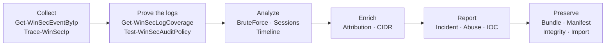

<div align="center">

# 🛡️ WinSecHunter

**What did this attacker IP do to your estate — and can you prove it?**

`v2.1.0` · 20 cmdlets · 156 catalogued events · 6 channels · 14 hunt profiles · MITRE ATT&CK mapped

</div>

---

WinSecHunter is an incident-response toolkit for Windows security events. It collects every
event that references an IP address (IPv4, IPv6 or CIDR) from local logs, remote hosts over
WinRM and offline `.evtx` files, then turns the result into evidence and reports.

> [!NOTE]
> Version 2.1.0 is a production-hardening release: three defects that broke normal collection
> are fixed, and six reporting cmdlets were added. See [What's new](#whats-new-in-210).

## Five-minute start

```powershell
git clone https://github.com/paulmann/Get-Windows-Security-Events-By-IP.git
cd Get-Windows-Security-Events-By-IP
./build/Install-Dev.ps1 -Force

$events = Get-WinSecEventByIp 203.0.113.7 -LastDays 2 -PassHostStatus
$events | Test-WinSecBruteForce
$events | Get-WinSecIpTimeline -AsciiChart

$case = New-WinSecCase -SubjectIps 203.0.113.7 -Title 'Brute force vs VPN'
Export-WinSecInvestigation -Case $case -Event $events -Format All -PassThru
New-WinSecIncidentReport -Case $case -Event $events -Template Executive -Format Both -PassThru
```

Need the whole map? `Show-WinSecHunterHelp` prints the workflow, every cmdlet, the profiles,
configuration and troubleshooting. `Show-WinSecHunterHelp -Cmdlet <name>` details one cmdlet.

## How the work flows



## What's new in 2.1.0

| Area | Change |
|---|---|
| **Help** | `Show-WinSecHunterHelp` — one-stop reference, `-Cmdlet`, `-Markdown`, `-OutFile` |
| **Reports** | `New-WinSecIncidentReport` — Executive/Technical/Full, Markdown + self-contained HTML |
| **Abuse** | `New-WinSecAbuseReport` — RFC 5322 `.eml`, provider resolution, base64 evidence, redaction |
| **IOC** | `Export-WinSecIocList` — CSV, TXT, JSON, STIX 2.1 |
| **Evidence** | `Test-WinSecEvidenceIntegrity`, `Import-WinSecCase`, IOCs inside the manifest |
| **Collection** | Per-channel execution: a missing Sysmon/RDP/firewall log is `Skipped`, not fatal |
| **Reliability** | No crash without a time window; `-ComputerName` sweeps work; `-PassHostStatus` always arrives |

Full list: [Changelog](https://github.com/paulmann/Get-Windows-Security-Events-By-IP/blob/main/CHANGELOG.md).

## Where to go next

| I want to… | Page |
|---|---|
| Install and run my first sweep | [Getting Started](Getting-Started) |
| Look up a cmdlet, parameter or example | [Cmdlet Reference](Cmdlet-Reference) |
| Understand detection logic and thresholds | [Detection and Analysis](Detection-and-Analysis) |
| Produce an incident report or an abuse report | [Reporting and Abuse](Reporting-and-Abuse) |
| Preserve and verify evidence | [Evidence and Reporting](Evidence-and-Reporting) |
| Sweep many hosts or analyse EVTX | [Remote Collection](Remote-Collection) |
| Configure options and API keys | [Configuration](Configuration) |
| Understand internals | [Architecture](Architecture) |
| Fix a problem | [Troubleshooting and FAQ](Troubleshooting-and-FAQ) |
| Decode a status code or logon type | [Reference Tables](Reference-Tables) |
| Build, test, contribute | [Development](Development) |
| See what is planned | [Roadmap](ROADMAP) |

## Platform and permissions

- **Collection** needs Windows and, for the Security log, an elevated session.
- **Remote collection** needs WinRM (`Enable-PSRemoting`) or a CIM session.
- **Analysis, reporting, evidence verification** run on any OS with PowerShell 7.6.
- **No telemetry.** The only outbound requests are the enrichment providers you enable and
  reverse DNS.

## Licence

**PolyForm Noncommercial License 1.0.0** — free for noncommercial use; commercial use, support
and custom terms require a licence from mid1977@gmail.com. See
[LICENSE](https://github.com/paulmann/Get-Windows-Security-Events-By-IP/blob/main/LICENSE).

Derivative of `Get-SecurityEventsByIP.ps1` by Mikhail Deynekin (mid1977@gmail.com,
https://deynekin.com). Releases up to 2.0.0 were GPL-3.0-or-later; 2.1.0 is relicensed by the
copyright holder.
