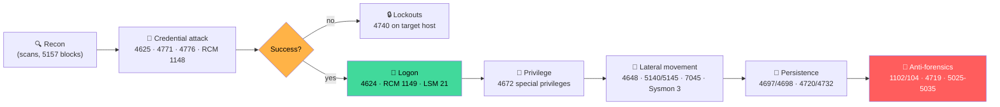
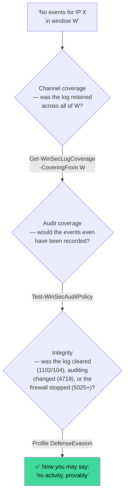

# 🎯 Problem Domain

*Why "find events by IP" is a deceptively hard problem — and what a proper
IP-centric investigation toolkit must solve.*

[← Home](Home)

---

## Table of contents

1. [The investigation that starts with an IP](#the-investigation-that-starts-with-an-ip)
2. [Anatomy of an IP-centric attack](#anatomy-of-an-ip-centric-attack)
3. [Seven ways "grep the log by IP" fails](#seven-ways-grep-the-log-by-ip-fails)
4. [The evidence doctrine: absence of evidence ≠ evidence of absence](#the-evidence-doctrine)
5. [Case study: what the legacy script missed](#case-study-what-the-legacy-script-missed)
6. [Requirements → features traceability](#requirements--features-traceability)
7. [Data sources landscape](#data-sources-landscape)

---

## The investigation that starts with an IP

Most Windows intrusion investigations begin the same way: a firewall alert, a
lockout storm, an EDR network detection, or a threat-intel hit produces **one
artifact — an IP address**. From that single address the responder must answer,
under time pressure and often under audit:

> [!IMPORTANT]
> 1. **Scope** — which hosts, accounts, sessions, and time window did this IP touch?
> 2. **Outcome** — did anything *succeed*? Is there an active foothold right now?
> 3. **Intent** — brute force? spraying? lateral movement? exfil channel? beaconing?
> 4. **Provenance** — external attacker, compromised internal host, NAT'd traffic, or a scanner?
> 5. **Provability** — can the logs *prove* the answers, or are they wrapped/disabled/unaudited/cleared?

Question 5 is the one that separates tooling from testimony. An incident report
that says *"no events found"* without a completeness proof is worth nothing in
a post-incident review, a regulator conversation, or a courtroom.

## Anatomy of an IP-centric attack

A single source IP typically produces a **multi-stage, multi-channel** footprint.
No single log tells the story:



Each stage lands in a **different channel with a different field layout**:

| Stage | Where the IP actually lives |
|---|---|
| Logon failures (4625/4771) | `EventData/Data[@Name='IpAddress']` — sometimes as `::ffff:a.b.c.d` |
| NTLM validation (4776) | **nowhere** — only a workstation *name*; correlate by time/account |
| RDP pre-auth (RCM 1149/1148) | `UserData/EventXML/Param3` — a different XML subtree entirely |
| RDP sessions (LSM 21–25) | `UserData/EventXML/Address` |
| Firewall (5156/5157) | `SourceAddress`/`DestAddress` + `%%14592`-encoded direction |
| Sysmon network (EID 3) | `SourceIp`/`DestinationIp` + process context |
| Post-exploitation (4688, 4697, 4698, 7045) | **inside strings**: `net use \\203.0.113.7\share`, service `ImagePath`, task XML |

A tool that searches one field in one log answers question 1 for ~30% of the story.

## Seven ways "grep the log by IP" fails

### 1️⃣ The truncation trap

The legacy script applied `-MaxEvents` **inside the query** and the time window
**afterwards**:

```powershell
# legacy behavior (v5.0.2) — silently wrong under load
$rawEvents = Get-WinEvent -FilterXml $q -MaxEvents 1000        # newest 1000…
$rawEvents = $rawEvents | Where-Object { $_.TimeCreated -ge $start }  # …then filtered
```

On a busy domain controller the newest 1000 events may cover 20 minutes. The
7-day window you asked for quietly became 20 minutes, with no warning.
**WinSecHunter pushes the time window into the XPath query**
(`TimeCreated[@SystemTime>=… and @SystemTime<=…]`), so `-MaxEvents` bounds the
window you actually requested.

### 2️⃣ The rendering trap

The same IPv4 address appears in logs as `203.0.113.7`, `::ffff:203.0.113.7`
(SChannel, RDP stacks), and occasionally `::ffff:cb00:7107` (hex-mapped).
IPv6 alternates between compressed (`2001:db8::1`) and expanded
(`2001:0db8:0000:…:0001`) forms. Exact-string matching finds one rendering
and misses the rest. WinSecHunter queries **all textual variants server-side**
and verifies client-side with **boundary-aware regex** — `203.0.113.7` must not
match `203.0.113.70`, but must match inside `::ffff:203.0.113.7` and
`203.0.113.7:55123`.

### 3️⃣ The subtree trap

Event Log XPath queries against `EventData` never see `UserData`. RDP's most
valuable events (1149 — network-level authentication success, fired *before*
4624) store the client IP in `UserData/EventXML/Param3`. A query shaped for the
Security log is blind on the RDP channel even when it "supports" it.

### 4️⃣ The event-ID tunnel vision

Hunting 4624/4625 only (the legacy default) misses Kerberos pre-auth failures
(4771 — the *domain* view of the same brute force), NTLM validation (4776),
RDP reconnects (4778/LSM 25 — attackers love abandoned sessions), lockouts
(4740 — which name the *victim host*), share access (5140/5145), service and
task installs (7045/4697/4698), and anti-forensics (1102/104/4719). The
WinSecHunter catalog spans **156 IDs across 6 channels**, ATT&CK-mapped, with
contextual events (no IP field) deliberately included — a lockout during a
brute-force window *is* evidence even though the IP never appears in it.

### 5️⃣ The timezone trap

`EventLogRecord.TimeCreated` is the **source machine's local time**. Sweep 200
hosts across regions and your "chronological" timeline is confetti. WinSecHunter
computes UTC **on the source side** for every record, sorts, buckets, bookmarks
and detects on `TimeUtc`, and keeps `TimeCreated` only for display.

### 6️⃣ The silent-failure trap

A 200-host sweep where 12 hosts are unreachable, 40 don't have Sysmon, and 3
deny the Security log is not "done" — it's 55 holes in your evidence. Legacy
tooling printed one error and continued, or worse, stayed quiet. WinSecHunter
emits a structured **`WinSecHostResult` per target** (`Completed` / `NoEvents` /
`Failed` / `Skipped`) so the report can state exactly what was and wasn't
observed.

### 7️⃣ The correlation trap

Raw event lists don't answer "did they get in?" That requires *stateful*
analysis: failures grouped into sliding-window bursts per (source, account),
spraying across accounts, stuffing across sources, and — the money question —
**a success for the same account/source within minutes after the failures**.
WinSecHunter's `Test-WinSecBruteForce` escalates exactly that pattern to
`BruteForceWithSuccess` / **Critical**: *assume compromise*.

## The evidence doctrine

> [!WARNING]
> **"No events found" is a conclusion, and conclusions require premises.**
> Before writing it into a report, prove three things:



WinSecHunter ships a cmdlet for each premise — a design choice, not an
afterthought. Logs wrap (default Security log is 20 MB — an RDP brute-force
storm can evict a day of history in hours), channels are disabled by default
(Firewall log, Sysmon), and audit policies vary wildly across an estate
(`Credential Validation` off ⇒ no 4776 ⇒ NTLM attacks invisible).

## Case study: what the legacy script missed

Real-world walkthrough — *RDP brute force against `VPN01`, October 2026*:

| Evidence | Legacy `Get-SecurityEventsByIP.ps1` v5.0.2 | WinSecHunter |
|---|---|---|
| 4625 type-10 failures with source IP | ✅ (Security log only) | ✅ |
| RCM 1148/1149 pre-auth results (`UserData` IP) | ❌ never queried | ✅ profile `Rdp` |
| LSM 25 session **reconnect** from the IP | ❌ | ✅ |
| The single 4624 success at 03:41 → **compromise verdict** | ❌ no correlation | ✅ `BruteForceWithSuccess` Critical |
| Session chain: LogonId → 4672 (admin!) → 4648 pivot to `SRV2` | ❌ | ✅ `Get-WinSecLogonSession` |
| 4740 lockouts on `DC01` naming VPN01 as trigger | ❌ (ID not queried) | ✅ contextual pass-through |
| 1102 "audit log cleared" on VPN01 at 04:02 | ❌ | ✅ Critical, profile `DefenseEvasion` |
| Was the 03:00–04:00 window even retained? | ❌ unknowable | ✅ `Get-WinSecLogCoverage` |
| Multi-host sweep of the VPN tier | ❌ local only | ✅ parallel WinRM + host statuses |
| Defensible export for the case file | CSV/HTML without hashes | ✅ SHA-256 manifest, case notes |

## Requirements → features traceability

| # | Investigator requirement | WinSecHunter feature |
|---|---|---|
| R1 | Find every trace of an IP/CIDR, any rendering, any IP-bearing field | 3-layer query engine, `-DeepScan` |
| R2 | Cover all IP-relevant channels incl. RDP ops, firewall, Sysmon | 156-event catalog, 14 profiles |
| R3 | Scale to the estate, account for every host | parallel WinRM, `-PassHostStatus`, retry |
| R4 | Work on acquired images, air-gapped | `-Path *.evtx`, offline analysis cmdlets |
| R5 | Answer "did they get in?" | success-after-failure, session reconstruction |
| R6 | Correct, decoded, classified output | NTSTATUS/Kerberos/%% decoders, ATT&CK tags |
| R7 | Prove evidence completeness | log coverage + audit-policy gap analysis |
| R8 | Court/handoff-grade artifacts | case bundles, SHA-256 manifest, self-contained HTML |
| R9 | Live monitoring during active incidents | `Trace-WinSecIp` bookmarked tail |
| R10 | Context without leaking secrets | offline-first attribution, env-only API keys |

## Data sources landscape

| Channel | Default state | IP-incident value |
|---|---|---|
| `Security` | ✅ enabled (Win10+/2016+), 20 MB default | Core: auth, Kerberos, account mgmt, anti-forensics |
| `System` | ✅ enabled | 7045 remote services, 104 log clears, 6008 dirty shutdowns |
| `TerminalServices-RemoteConnectionManager/Operational` | ✅ enabled since Win8/2012 | **1149/1148: RDP auth with client IP, pre-NLA** |
| `TerminalServices-LocalSessionManager/Operational` | ✅ enabled | 21–25: session lifecycle with source IP |
| `Windows Firewall With Advanced Security/Firewall` | ⚠️ logging off by default | 2004–2006 rule changes (5152-level packet logs are noisy) |
| `Sysmon/Operational` | ❌ separate install | EID 3: process ↔ IP with direction — richest hunting source |

> [!TIP]
> Enable what you're missing *before* the next incident: [Audit Policy Guide](Audit-Policy-Guide).

---

**Next:** [Getting Started →](Getting-Started) · Related: [Architecture](Architecture) · [Detection & Analysis](Detection-and-Analysis)
