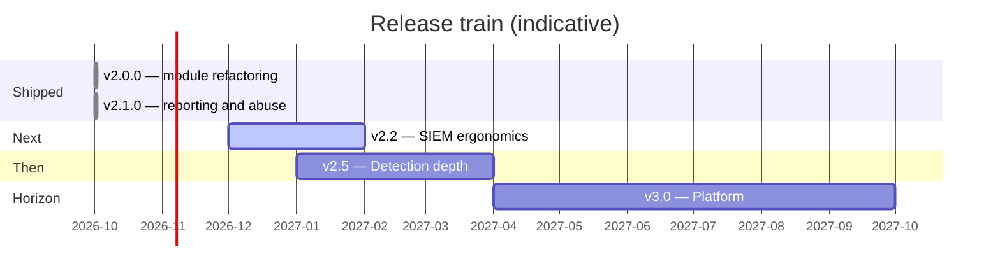

# 🗺️ ROADMAP

Where WinSecHunter goes next — prioritized by **investigator value per unit of
complexity**, grounded in what the v2.0 architecture already enables. This page
is the proposal surface: comment in
[Discussions/Issues](https://github.com/paulmann/Get-Windows-Security-Events-By-IP/issues),
or pick up a `help wanted` item.

[← Home](Home)

---

## ✅ Shipped — v2.0.0 (2026-10)

The refactoring itself: module architecture, 156-event catalog, 3-layer query
engine, remote/EVTX collection, detection suite, session reconstruction,
coverage/audit analyzers, evidence bundles, 132 tests, CI/CD. See
[CHANGELOG](https://github.com/paulmann/Get-Windows-Security-Events-By-IP/blob/main/CHANGELOG.md).

---

## ✅ Shipped — v2.1.0 (2026-10)

The reporting and reliability release: `Show-WinSecHunterHelp`, incident reports
(Executive/Technical/Full, Markdown + self-contained HTML), abuse reports (RFC 5322 `.eml`
with evidence attachments and account redaction), IOC export (CSV/TXT/JSON/STIX 2.1),
evidence verification, case re-import, per-channel host status, and fixes for three defects
that broke normal collection.

## 🎯 v2.2 — SIEM ergonomics *(next)*

Small, high-leverage items that pay off in every single investigation.

| Item | Why it matters | Size |
|---|---|---|
| **ATT&CK Navigator layer export** | One click from findings → heat-map layer JSON (`navigator` v4.4 schema): techniques observed, severity-colored, case-annotated. The single most-requested artifact in IR reporting | S |
| **CEF / LEEF / syslog export** | Direct ingestion for Splunk CIM, QRadar, ArcSight without a CSV mapping project; `Export-WinSecInvestigation -Format Cef` | S |
| **SIEM ingestion adapter** | `Import-WinSecEvent -Path splunk-export.csv` → `WinSecEvent[]`: analyze what the SIEM collected when EVTX isn't available (field-mapping profiles per Splunk/Elastic/Sentinel exports) | M |
| **Beaconing detector** | `Test-WinSecBeaconing`: regularity analysis (interval mean/σ, jitter %) on timeline buckets + Sysmon EID 3 — C2 detection from the same data we already collect | M |
| **Offline GeoIP (MaxMind MMDB)** | Country/ASN/city without any API — air-gapped attribution; pure-.NET MMDB reader, user supplies the (licensed) database file | M |
| `-ExcludeIp` allow-list | Cut known scanners/monitoring from sweeps at query time (server-side gate excludes them too) | S |
| WinRM & PowerShell log channels in catalog | `Microsoft-Windows-WinRM/Operational` + `PowerShell/Operational` 4103/4104 — script blocks and remote sessions frequently embed attacker IPs; profile `Lateral` grows | S |
| HTML report: per-host drill-down + Navigator deep-link | Reviewers stop grepping the giant event table; ATT&CK chips link to a pre-populated Navigator | S |
| Parallel local EVTX processing | `-Path` with 40 files currently sequential; `ForEach-Object -Parallel` over files with the same host-status model | S |

**Exit criteria:** all items tested (suite ≥ 160), docs + wiki updated, zero
analyzer warnings, no breaking changes to v2.0 output schemas.

---

## 🕵️ v2.5 — Detection depth

From "find the IP's events" to "explain the campaign".

| Item | Why it matters | Size |
|---|---|---|
| **Cross-host pivot graph** | Chain 4648 (`SubjectLogonId→TargetLogonId`), 4624 type-3 pairs and Sysmon EID 3 across sweep results into a directed graph (`Computer → Computer`, annotated accounts/sessions); output objects + GraphML for visualization tools | L |
| **Multi-IP campaign correlation** | Aggregate findings across a CIDR sweep: shared accounts, lockstep timing (botnet signature), per-IP roles (scanner vs. exploit vs. C2) | M |
| **Kerberos attack heuristics** | Golden/silver-ticket smells from catalog data: 4769 RC4 encryption (0x17), ticket lifetimes, pre-auth-less TGTs (4768 without 4771), service-ticket request storms per source | M |
| **WEC / ForwardedEvents support** | `-LogName ForwardedEvents` awareness: parse the embedded `System/Computer` origin instead of the collector, so fleet-wide forwarded logs sweep correctly | M |
| **Watchlist mode** | `Start-WinSecWatchlist`: scheduled collection for N IPs (config file), JSONL append + periodic bundle; the "stakeout" workflow without a SIEM | L |
| **STIX 2.1 bundle export** | `indicator` (IPs), `observed-data` (events summary), `relationship` (attributed-to) → MISP/TIP import; makes WinSecHunter a first-class citizen in intel pipelines | M |
| **Sigma-style finding export** | Emit the detection context (IDs, window, thresholds, grouping) as a portable rule sketch analysts can lift into their SIEM | S |
| Catalog: WMI-Activity 5861, TerminalServices-Gateway, DHCP/RRAS | More lateral-movement & network-access surface with IP fields | S |
| Distributed lockout triangulation | Correlate 4740 `SubjectComputerName` chains to find the *real* source host behind DC-reported lockouts (classic multi-tier puzzle) | M |

---

## 🏔️ v3.0 — Platform horizon

Bigger bets; each deserves its own design doc (RFCs welcome via issues).

| Item | Ambition | Risk/notes |
|---|---|---|
| **Cross-platform EVTX parsing** | Analyze acquired `.evtx` on Linux/macOS without Windows — embed a managed EVTX reader (binary format parser) behind the existing `ConvertTo-WinSecEvent` contract | Format is documented; chunk/binary-template edge cases are the work. Keeps "analysis anywhere" promise complete |
| **ETW live trace** | Replace `Trace-WinSecIp` polling with a real ETW consumer (Microsoft-Windows-* providers) for sub-second, gap-free live monitoring | Native interop or dependency decision needed; polling stays as fallback |
| **Public dataset CI** | Nightly integration tests replaying open datasets (Mordor/Security Datasets EVTX corpora) through collection→detection→export, asserting known ground truth | Licensing + artifact storage; start with a small curated set |
| **Detection plugin model** | Signed script-block plugins consuming `WinSecEvent[]` → `WinSecBruteForceFinding`-shaped output; ships a `plugins/` folder (beaconing, RDP hijack patterns, time-of-day anomalies) | Sandboxing/ trust model must stay conservative — unsigned plugins load only with an explicit switch |
| **Local review dashboard** | `Start-WinSecReview <caseDir>`: static-site regeneration of the bundle with cross-filtering (host/account/time), zero network | Blazor-static or plain generated JS? (HTML report stays JS-free by policy) |
| Authenticode signing + winget/Chocolatey | Distribution trust for enterprise fleet deployment | Requires cert funding/maintenance |
| Cross-case memory | Local SQLite index of past cases: "we saw this IP in INC-3987, verdict BruteForceWithSuccess" — institutional memory for SOCs | Privacy/retention policy hooks mandatory |

---

## 🚫 Deliberately NOT doing

Design boundaries are roadmap items too. These keep the tool trustworthy:

| Non-goal | Rationale |
|---|---|
| **Active response** (blocking IPs, killing sessions, disabling accounts) | WinSecHunter is read-only against evidence by doctrine. Response belongs to SOAR/EDR with their own audit trails. A collection tool that can mutate the estate becomes an attacker tool |
| Windows PowerShell 5.1 support | Classes, `-Parallel`, .NET 10 behaviors are load-bearing; dual-targeting would tax every PR |
| Mandatory cloud services | Offline-first is non-negotiable for IR (air-gapped labs, classified estates); TI stays opt-in |
| Secrets in config files / parameters | Env-var indirection only — history, transcripts and process lists must stay clean |
| Compiled dependencies in core module | Copy-in, dot-source, debug-at-3am property. Optional companions (MMDB reader, ETW) may live in separate distributables |
| Localization of output | English-only artifacts keep evidence comparable across teams and courts; UI localization is not the product |

---

## 🔧 How to influence this roadmap

1. **Upvote/comment** the tracking issue for each milestone (pinned in the repo).
2. **Propose**: open an issue with the `roadmap-proposal` label — the format
   that gets traction: *investigator question it answers → data it needs →
   which layer it touches* ([architecture](Architecture)).
3. **Build**: small items above are marked S — good first PRs; read
   [Development](Development) first (conventions are CI-enforced).
4. Version numbers are trains, not promises: items move between trains based on
   contributor capacity; `help wanted` + `good first issue` mark the onboardable ones.

---

*Last reviewed: 2026-10-21, alongside the v2.1.0 release.*
