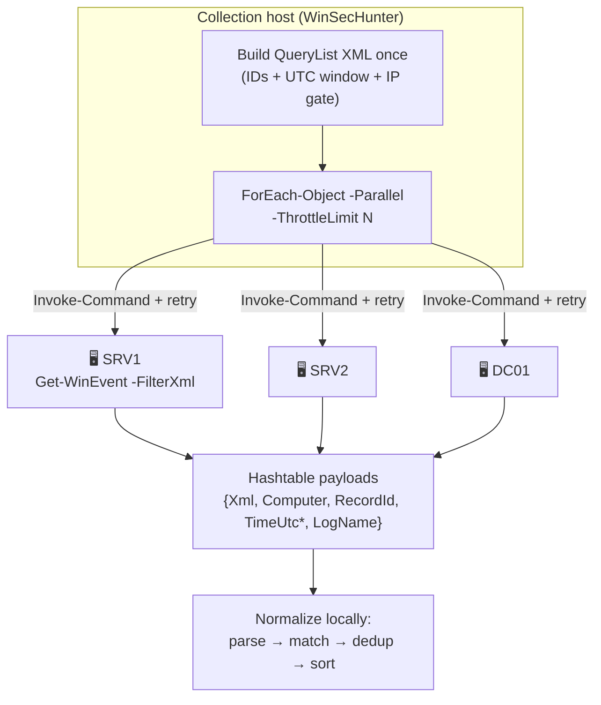

# 🌐 Remote Collection & Offline Forensics

Sweeping the estate over WinRM, using CIM sessions, and working acquired EVTX
images — including the accountability model that makes fleet sweeps defensible.

[← Home](Home)

---

## Table of contents

1. [Transport model](#transport-model)
2. [WinRM prerequisites](#winrm-prerequisites)
3. [Credentials & authentication](#credentials--authentication)
4. [Parallelism & throttling](#parallelism--throttling)
5. [Per-host status model](#per-host-status-model)
6. [CimSession transport](#cimsession-transport)
7. [Offline EVTX forensics](#offline-evtx-forensics)
8. [Remote troubleshooting](#remote-troubleshooting)

---

## Transport model



Design decisions worth knowing:

- **The query is built once** and executed identically everywhere — no
  per-host query drift.
- **Remote blocks return plain hashtables**, not typed objects: zero module
  dependencies on targets, CLIXML-safe serialization, parsing happens centrally.
- **`TimeUtc` is computed on the source machine** (`TimeCreated.ToUniversalTime()`
  inside the remote block) — correct even when targets span time zones.
- **Retry**: transport failures retry once (configurable `-RetryCount 0..5`,
  1.5 s backoff) before a host is marked `Failed`.
- **`-CimSession` runs sequentially** by design — CIM handles are not safe to
  fan out across runspaces.

## WinRM prerequisites

On each **target** (one-time, elevated):

```powershell
Enable-PSRemoting -Force
# opens TCP 5985 (HTTP) / 5986 (HTTPS after cert setup),
# creates the firewall rule 'Windows Remote Management (HTTP-In)'
```

| Environment | What works out of the box |
|---|---|
| Same AD domain | Kerberos mutual auth, no extra config |
| Cross-domain / forest trust | Kerberos with proper SPNs, else Negotiate |
| Workgroup / external IPs | HTTPS listener + certificate, or `-Authentication Basic` over TLS, or CredSSP (⚠️ below) |
| Azure VMs / cloud | `Enable-PSRemoting` + NSG allow 5985/5986 from the jump box |

The **querying identity** needs, on the target: membership in local
`Administrators` *or* the `SeSecurityPrivilege` user right ("Manage auditing
and security log") for the Security channel. Service accounts dedicated to IR
sweeps are the clean answer — see the group-policy route in
[Audit Policy Guide](Audit-Policy-Guide#5-remote-collection-prerequisites).

> [!WARNING]
> **CredSSP** (`-Authentication Credssp`) delegates your credentials to the
> target — a compromised target harvests them. Enable only for the specific
> jump→target pairs that truly need it, prefer Kerberos/HTTPS, and disable
> afterwards (`Disable-WSManCredSSP`).

## Credentials & authentication

```powershell
$cred = Get-Credential   # or a gMSA-backed PSCredential from your vault

Get-WinSecEventByIp 203.0.113.7 -ComputerName $hosts -Credential $cred `
    -Authentication Negotiate -SessionOption (New-PSSessionOption -NoMachineProfile -OpenTimeout 30000)
```

- `-Credential` is passed to `Invoke-Command` and **never serialized to disk**
  by WinSecHunter; remote blocks receive no credential material.
- `-Authentication` mirrors WinRM values: `Basic` · `Negotiate` ·
  `NegotiateWithImplicitCredential` · `Credssp` · `Digest` · `Default`.
- `-SessionOption` accepts any `New-PSSessionOption` object (timeouts, proxy,
  SkipCN checks for HTTPS labs).

## Parallelism & throttling

```powershell
# 200 hosts, 32 concurrent, unlimited records, whole retained history
Get-WinSecEventByIp 203.0.113.7 -ComputerName (Get-Content hosts.txt) -Credential $cred `
    -ThrottleLimit 32 -MaxEvents 0 -PassHostStatus
```

| Knob | Default | Guidance |
|---|---|---|
| `-ThrottleLimit` | `8` (config `DefaultThrottleLimit`) | 16–64 for LAN jump boxes; each slot holds one WinRM connection + result set |
| `-MaxEvents` | `5000`/host (config) | `0` = unlimited — pair with a tight time window, not with `-Profile All` on DCs |
| `-RetryCount` | `1` | flaky WAN links: 2–3 |
| Progress | automatic | parallel `Write-Progress` aggregates: host → status → event count |

Memory rule of thumb: budget ~2 KB per event object (more with
`-IncludeRawXml`). A 200-host sweep returning 50k events ≈ 100–200 MB —
comfortable; `-DeepScan -Profile All -MaxEvents 0` across a DC fleet is how
you find out what swap is for.

## Per-host status model

With `-PassHostStatus`, the output stream **starts** with one `WinSecHostResult`
per target, then the events:

```powershell
$out = Get-WinSecEventByIp 203.0.113.7 -ComputerName $hosts -PassHostStatus
$status = $out | Where-Object { $_.GetType().Name -eq 'WinSecHostResult' }
$events = $out | Where-Object { $_.GetType().Name -eq 'WinSecEvent' }

$status | Group-Object Status | Format-Table Name, Count
$status | Where-Object Status -eq 'Failed' | Format-Table Computer, ErrorMessage
```

| Status | Meaning | Typical cause |
|---|---|---|
| `Completed` | query ran, ≥1 event | — |
| `NoEvents` | query ran, 0 matches | genuinely quiet host (a *result*, not a failure) |
| `Skipped` | channel not installed / not accessible by design | Sysmon absent, RDP logs on a DC, access denied to an optional log |
| `Failed` | transport or query error | WinRM off, DNS, auth, firewall — full message in `ErrorMessage` |

> [!IMPORTANT]
> A sweep report should state all four counts. "We queried 200 hosts" is
> meaningless without "…187 completed, 9 failed (list), 4 skipped channels".
> `Failed` hosts are also emitted as non-terminating errors, so
> `-ErrorAction Stop` turns them into hard stops and
> `-ErrorVariable ev` captures them.

## CimSession transport

When your environment standardizes on CIM sessions (proxy configs, custom
`CimSessionOption`, existing session pools):

```powershell
$sessions = New-CimSession -ComputerName SRV1, SRV2 -Credential $cred
Get-WinSecEventByIp 203.0.113.7 -CimSession $sessions -LastDays 2 -PassHostStatus
$sessions | Remove-CimSession
```

Executed via `Invoke-Command -CimSession` (sequential). Status model identical;
`Computer` labels come from the session objects.

## Offline EVTX forensics

Acquired images need **no WinRM, no admin rights on any remote system** — just
read access to the files and a Windows analysis host:

```powershell
# Whole case directory, deep scan, keep raw XML for the evidence bundle
$events = Get-WinSecEventByIp 203.0.113.7 -Path 'E:\case042\*.evtx' `
              -DeepScan -IncludeRawXml -MaxEvents 0

# Coverage of the images themselves (retention bounds of what was acquired)
Get-WinSecLogCoverage -Path 'E:\case042\*.evtx' |
    Format-Table LogName, RecordCount, OldestRecordUtc, NewestRecordUtc
```

Acquisition tips:

- Copy live `.evtx` with `wevtutil epl Security C:\ir\Security-%COMPUTERNAME%.evtx`
  or `Copy-Item` from `C:\Windows\System32\winevt\Logs\` (VSS for locked files).
- `Get-WinSecLogCoverage -CoveringFrom <window>` on the *live* host tells you
  whether the acquisition even contains the window you care about.
- File-mode queries rebuild the XPath with each file's path (`-PathOverride`
  internally), so multi-channel QueryLists work per file.
- Timestamps: EVTX `SystemTime` is UTC in the XML — `TimeUtc` is exact;
  `TimeCreated` renders in the *analysis* machine's zone.

## Remote troubleshooting

| Symptom | First check | Fix |
|---|---|---|
| `Connecting to remote server failed` | `Test-WSMan -ComputerName HOST` | `Enable-PSRemoting`, firewall 5985/5986, DNS |
| `Access is denied` on Security log | querying identity rights | local Administrators or `SeSecurityPrivilege` on target |
| Kerberos errors cross-domain | SPNs / trust | `-Authentication Negotiate`, or HTTPS listener |
| Timeouts on WAN | default open timeout | `-SessionOption (New-PSSessionOption -OpenTimeout 60000)` |
| Host has no Sysmon/RDP channels | `Skipped` status | expected — not an error; note it in the report |
| Partial results, log wrapped | `Get-WinSecLogCoverage -ComputerName …` | retention gap warning; state the bound in the report |
| CredSSP rejected | both sides must enable | `Enable-WSManCredSSP -Role Client -DelegateComputer HOST` (+ Server role on target) — ⚠️ risk above |

---

## Per-channel status (2.1.0)

A remote host is queried channel by channel. The host result carries `LogDetails`:

```powershell
$status = Get-WinSecEventByIp 203.0.113.7 -ComputerName SRV1, SRV2 -LastHours 12 -PassHostStatus
$status | Format-Table Computer, Status, EventsFound, ErrorMessage
$status | ForEach-Object { $_.LogDetails } | Format-Table LogName, Status, EventsFound, Error
```

| Channel status | Meaning | What to do |
|---|---|---|
| `Completed` | records returned | nothing |
| `NoEvents` | query ran, no match | widen the window or use `-DeepScan` |
| `Skipped` | channel absent, disabled or access denied | expected on servers without the role; elevate for Security |
| `Failed` | real error | read `Error`; check WinRM, permissions, query |

A missing Sysmon or RDP channel no longer aborts the host, and `-PassHostStatus` is emitted
before any diagnostic message, so statuses are never lost behind an error.

**Next:** [Threat Intel & Attribution →](Threat-Intel-and-Attribution) · Related: [Troubleshooting & FAQ](Troubleshooting-and-FAQ)
